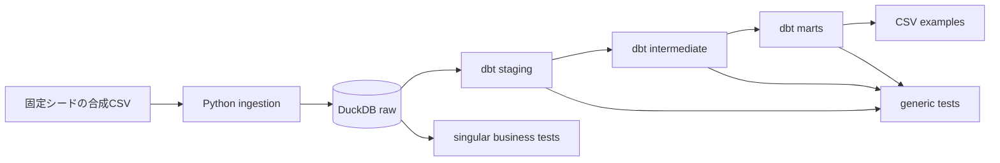

# Stream Insight Pipeline

架空のライブ配信データを、Pythonで生成・取り込みし、DuckDBとdbtで分析用テーブルへ変換する再現可能なデータパイプラインです。

実在する配信者、視聴者、コメント、動画ID、映像、音声は使用していません。すべての入力は固定シードから生成した合成データです。

切り抜き制作に関わる中で、配信を調べるための情報を整理し、確かめやすくすることに関心を持ちました。
この作品は、架空のデータを使って取り込みから集計・品質検査までを再現する学習用サンプルです。
設計・実装・テストにはAIを広く利用しています。実配信への適用や候補順位の有効性は検証していません。

## はじめに：何を見られるか

| 読みたい内容 | 入口 |
| --- | --- |
| 合成データが集計結果になるまでの流れ | [データフロー](#データフロー)・[入力データ](#入力データ) |
| 手元で再現する方法と結果の置き場 | [クイックスタート](#クイックスタート) |
| データの誤りを検査する方法 | [品質検査が失敗することを確かめる](#品質検査が失敗することを確かめる) |
| 設計の考え方とAIの利用範囲 | [設計判断](#設計判断)・[AI利用説明](AI_USAGE.md) |

関連作品：[Multilingual Clip Pipeline](https://github.com/mIILAKA/multilingual-clip-pipeline) では、切り抜き制作の品質検査と、私の制作上の判断を紹介しています。

## 30秒で分かる特徴

- Pythonで4種類・合計1,012行の合成データを決定的に生成
- DuckDBのrawテーブルを置換ロードし、再実行による重複を防止
- dbtでstaging／intermediate／martsの3層へ変換
- JOIN、GROUP BY、CTE、ウィンドウ関数、CASEを実際の集計に使用
- `unique`、`not_null`、`relationships`、`accepted_values`と業務固有テストを実行
- GitHub Actionsで生成から分析結果までを新しい環境で再現
- 意図的な不正データを入れ、品質検査が失敗することも確認可能

## データフロー



## クイックスタート

必要なものはPython 3.12と[uv](https://docs.astral.sh/uv/)です。

```powershell
uv sync --locked --all-groups
uv run python -m stream_insight demo
```

成功時は次の成果物が`build/demo/`に作られます。

- `stream_insight.duckdb`: rawからmartsまでを含むDuckDB
- `data/*.csv`: 固定シードの合成入力
- `examples/stream_summary.csv`: 配信単位の集計例
- `examples/clip_candidates.csv`: 優先順位付き候補区間の例
- `dbt_target/`: dbtの実行結果

既定データではraw 1,012行から、配信サマリー12行と候補区間36行を作ります。

たとえば `examples/clip_candidates.csv` は、架空配信ごとに候補区間とその集計結果を
確認するための出力です。順位は後述の規則で計算した**合成データ上の例**です。
実データを分析した成果や、実際の切り抜きの良し悪しを判定する機能ではありません。

## 品質検査が失敗することを確かめる

次のコマンドは、最初の候補区間を`end_sec <= start_sec`に壊します。dbtの業務固有テストが検出するため、終了コード1になるのが正しい動作です。

```powershell
uv run python -m stream_insight demo `
  --work-dir build/invalid-demo `
  --invalid-case candidate_interval
```

## 入力データ

| データ | 主な列 | 行数 | 役割 |
|---|---|---:|---|
| `channels.csv` | channel_id, channel_name, language | 4 | 架空チャンネルの属性 |
| `streams.csv` | stream_id, channel_id, started_at, duration_sec | 12 | 架空配信の日時と尺 |
| `chat_events.csv` | event_id, stream_id, occurred_at, reaction_score | 960 | 時系列の反応イベント |
| `clip_candidates.csv` | candidate_id, stream_id, start_sec, end_sec, status | 36 | 切り抜き候補区間 |

すべての識別子には`syn_`を付け、チャンネル名は`Synthetic Channel`から始めています。

## dbtモデル

```text
staging
├── stg_channels
├── stg_streams
├── stg_chat_events
└── stg_clip_candidates
        ↓
intermediate
├── int_chat_by_minute
└── int_candidate_scores
        ↓
marts
├── mart_stream_summary
└── mart_clip_candidates
```

- `mart_stream_summary`: 配信ごとの反応件数、平均スコア、最も反応が高かった1分
- `mart_clip_candidates`: 候補区間内の反応、品質状態、配信内の優先順位

候補の順位は、区間内の平均反応スコア、反応件数、候補IDの順に並べた例です。
架空の反応データによる機械的な順位であり、面白さやタレントの魅力を測定したものではありません。
実際の題材選びには、会話の文脈や正確さを含めた人の判断が必要です。

詳しい責務と依存関係は[アーキテクチャ](docs/architecture.md)、列定義は[データ辞書](docs/data_dictionary.md)に記載しています。

## テスト

```powershell
uv run pytest
uv run ruff check .
uv run ruff format --check .
```

テストでは次を確認します。

- 同じシードから同じCSVが生成される
- 実在データに見える名前を生成しない
- 必須列が欠けた入力をPython側で拒否する
- 同じ入力を2回ロードしても行数が増えない
- dbtの全モデルと品質検査が正常データで成功する
- 不正な候補区間をdbtが拒否する

## 設計判断

### DuckDBを選んだ理由

採用担当者がクラウド契約やサーバー構築なしで、1ファイルのデータベースを再現できるためです。SQLとdbtの設計・品質検査を評価できる最小構成を優先しました。

### rawで業務ルールを判定しない理由

Pythonの取り込みは、ファイルと必須列の契約だけを確認します。区間や外部キーなどのデータ品質はdbtへ集約し、「取り込めない」と「取り込めるが品質違反」を区別します。

### 今回含めなかったもの

AWS／GCPへの配備、画面、LLM分析、Go API、Kubernetes、Terraform、実YouTubeデータは含めません。期限内にSQL、データモデリング、品質検査、再現性を完成させるための判断です。

## リポジトリ構成

```text
analytics/                  dbtプロジェクト
src/stream_insight/         生成・取込・実行CLI
tests/                      単体・統合テスト
docs/                       設計とデータ辞書
.github/workflows/ci.yml    再現性の検査
```

## 安全性とAI利用

- 脆弱性や秘密情報の報告方法は[SECURITY.md](SECURITY.md)
- AI支援の利用範囲は[AI_USAGE.md](AI_USAGE.md)
- この作品の動作確認と、作者が各技術を独力で設計・実装できることは別です
- このプロジェクト自身は外部APIや生成AIへデータを送信しません

## License

[MIT License](LICENSE)
